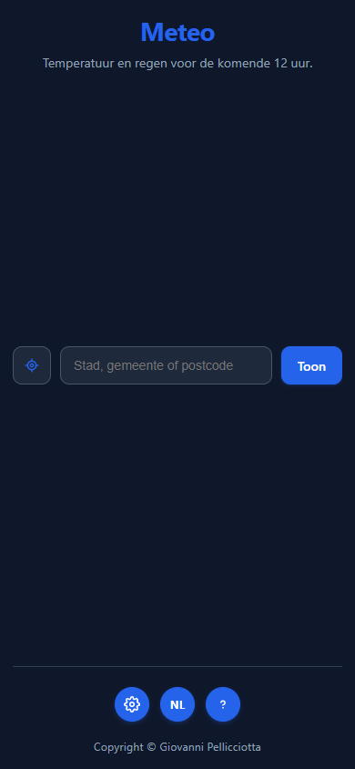
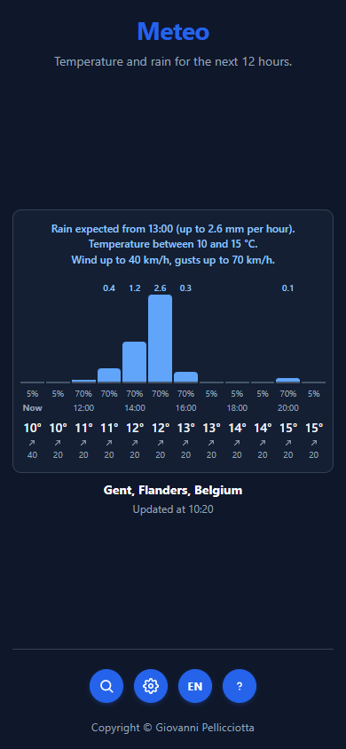

# T0030: Drop the quiz leftovers: unused icons, classes, and tokens, before adopting the design system.

## Goals
Remove the icons, CSS classes, and tokens left from the quiz, which no current screen uses.
Keep every screen's appearance unchanged; screenshots before and after must match.
Start once support.webapp finishes its generator phase; see the [roadmap](../../../support.webapp/docs/roadmap.md), Phase 4.

## Task Execution Steps
- [x] **[Read]**      Read the named ADRs and the app at a recorded commit.
- [x] **[Decide]**    Write declared files, size estimate, tests, and the completion check into the technical specification.
- [x] **[Implement]** Write the failing tests named in the technical specification.
- [x] **[Verify]**    Run the new tests and record their failure output in validation-proof.md.
- [x] **[Implement]** Remove the unused icons, classes, and tokens.
- [x] **[Verify]**    Run the tests and the completion check until they pass.
- [x] **[Visual]**    Record the lossless switch proof: screenshots at 390 and 1440 px, light and dark.
- [x] **[Doc]**       List every visual difference as a fix or deliberate change, and update CHANGELOG.md.
- [ ] **[Review]**    Obtain review approval of the finished work before completion.

## Execution Log
- [2026-11-13] **[Doc]**
  Created from the support.webapp adoption roadmap at the user's request.

- [2026-11-13] **[Doc]**
  Removed 16 icons, 11 classes, 8 tokens; npm test and browser tests pass; screenshots identical apart from three noisy 320px captures.

- [2026-11-13] **[Read]**
  Read the app at 8937c32; audited icons, classes, and tokens against index.html and js.

- [2026-11-13] **[Decided]**
  Decided to keep changelog-badge-* classes, since the changelog renderer builds them from area names.

- [2026-11-13] **[Implement]**
  Wrote tests/leftovers.test.js; 37 tests failed before the removal.

- [2026-11-13] **[Verify]**
  Recorded the failing output in validation-proof.md.

- [2026-11-13] **[Implement]**
  Removed 16 icons, 11 classes, and 8 tokens.

- [2026-11-13] **[Verify]**
  npm test passed 142 tests; browser tests exit 0.

- [2026-11-13] **[Visual]**
  Compared 104 screenshots at 390 and 1440 px, light and dark; only three noisy 320 px captures differ.

- [2026-11-13] **[Doc]**
  Changelog updated in English and Dutch; no visual differences to list.

- [2026-11-13] **[Review]**
  Round 1 requested (mode: agent).

## Screenshots
Before and after, all identical; see validation-proof.md.
- Start, 1440 px light:  
- Start, 390 px dark:  
- Forecast, 1440 px light:  
- Forecast, 390 px dark:  
