# T0033: Rename data-theme-color to data-accent and document every palette override and AA exception.

## Goals
Rename the `data-theme-color` attribute to `data-accent`, keeping the accent names as values.
List every palette override and deliberate AA exception in meteo's style guide, including white labels on yellow.
Follow [ADR-0002](../../../../support.webapp/docs/adrs/ADR-0002-looks.md).
Prove a lossless switch as [ADR-0007](../../../../support.webapp/docs/adrs/ADR-0007-documentation-and-verification.md) requires.

## Task Execution Steps
- [x] **[Read]**      Read the named ADRs and the app at a recorded commit.
- [x] **[Decide]**    Write declared files, size estimate, tests, and the completion check into the technical specification.
- [x] **[Implement]** Write the failing tests named in the technical specification.
- [x] **[Verify]**    Run the new tests and record their failure output in validation-proof.md.
- [x] **[Implement]** Rename the attribute and document the overrides and AA exceptions.
- [x] **[Verify]**    Run the tests, the vendored check, and the completion check until they pass.
- [x] **[Visual]**    Record the lossless switch proof: screenshots at 390 and 1440 px, light and dark.
- [x] **[Doc]**       List every visual difference as a fix or deliberate change, and update CHANGELOG.md.
- [x] **[Review]**    Obtain review approval of the finished work before completion.

## Execution Log
- [2026-11-13] **[Doc]**
  Created from the support.webapp adoption roadmap at the user's request.

- [2026-11-13] **[Read]**
  Read ADR-0002, ADR-0007, the T0031 assessment, T0032 spec, and meteo at 33c5cc9.
  - Look accent rules start matching once the attribute is renamed.
  - App :root[data-accent] rules outrank them, so the switch stays lossless.

- [2026-11-13] **[Decide]**
  Wrote decisions, declared files, size estimate of 7 files and 140 lines, tests, and the completion check into technical-spec.md.

- [2026-11-13] **[Implement]**
  Wrote failing tests: tests/accent.test.js and two shell-browser checks for the accent preview and the palette attribute.

- [2026-11-13] **[Verify]**
  Recorded the red phase in validation-proof.md: 13 unit tests and 2 browser checks fail.

- [2026-11-13] **[Implement]**
  Renamed the attribute in theme.js, config-view.js, and index.html; moved blue tokens to :root[data-accent]; added the style guide and docs index.
  - Files touched: 7.
  - Lines touched: 78.

- [2026-11-13] **[Verify]**
  devops.py check, check.mjs, docs lint, and npm run test:browser pass: 28 Python, 174 Vitest, 400 browser checks.

- [2026-11-13] **[Visual]**
  Recorded before and after captures at 390 and 1440 px, light and dark: 0 style differences, 24 identical screenshots.
  - proof/before, proof/after.

- [2026-11-13] **[Doc]**
  Listed no visual differences, since styles and screenshots match; updated README, CHANGELOG.md, and CHANGELOG.nl.md.
  - Files touched: 7.
  - Lines touched: 78.
  - Reopenings: 0.

- [2026-11-13] **[Decided]**
  Kept dark blue's #2563eb fill and accent headings, listed as AA exceptions; follow-ups T0038 lint docs, T0039 dark blue.
  - [Feedback Needed] dark blue: keep meteo's fill or adopt bright's?.

- [2026-11-13] **[Review]**
  Round 1 requested (mode: agent).

- [2026-11-13] **[Review]**
  Round 1 approved by @codex: [Decided]** Approved; no blocking findings.
  - Findings: [review-findings-1.md](T0033-rename-data-theme-color-to-data-accent-and/review-findings-1.md).

- [2026-11-13] **[Complete]**
  Task completed successfully.

## Screenshots
Before and after captures are byte-identical; validation-proof.md records the comparison.
- start, 390 px light: 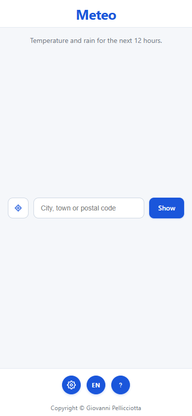 
- start, 390 px dark:  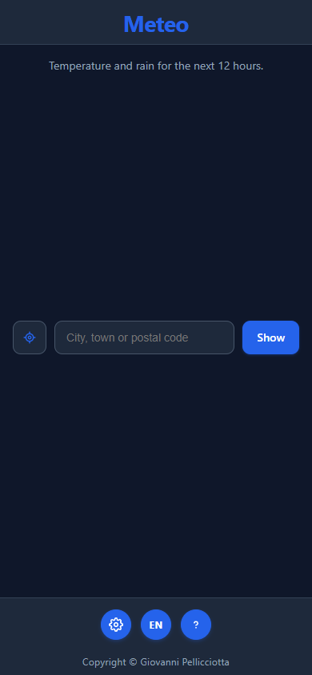
- start, 1440 px light: 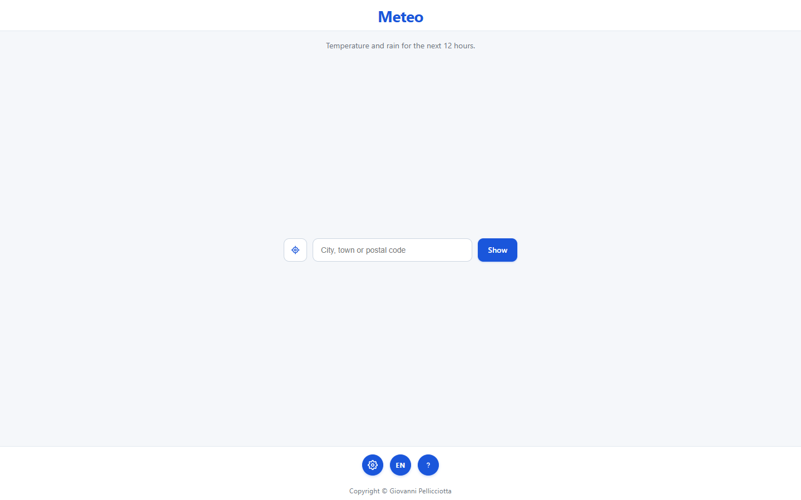 
- start, 1440 px dark: 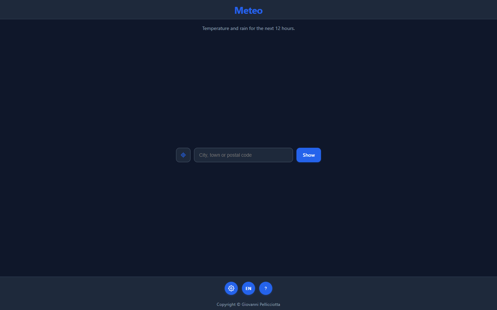 
- forecast, 390 px light: 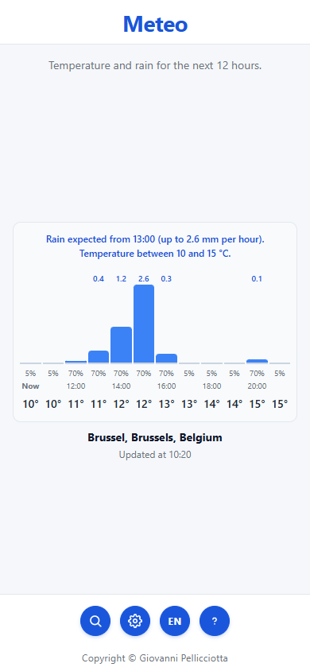 
- forecast, 390 px dark: 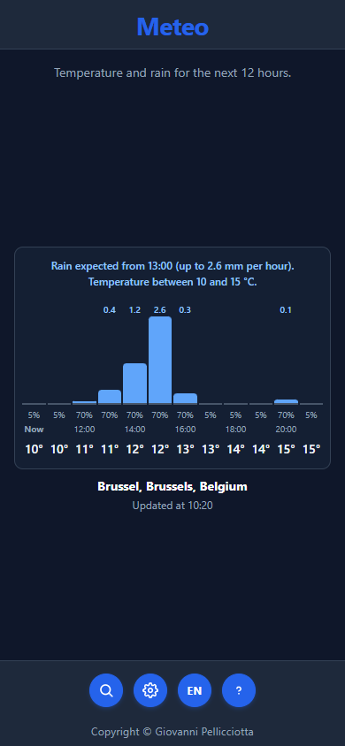 
- forecast, 1440 px light: 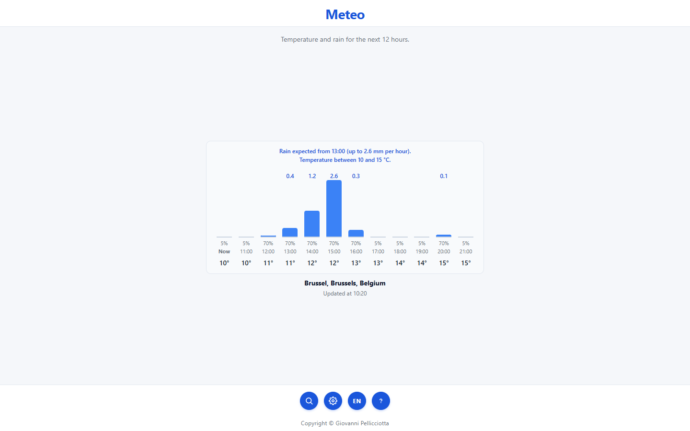 
- forecast, 1440 px dark: 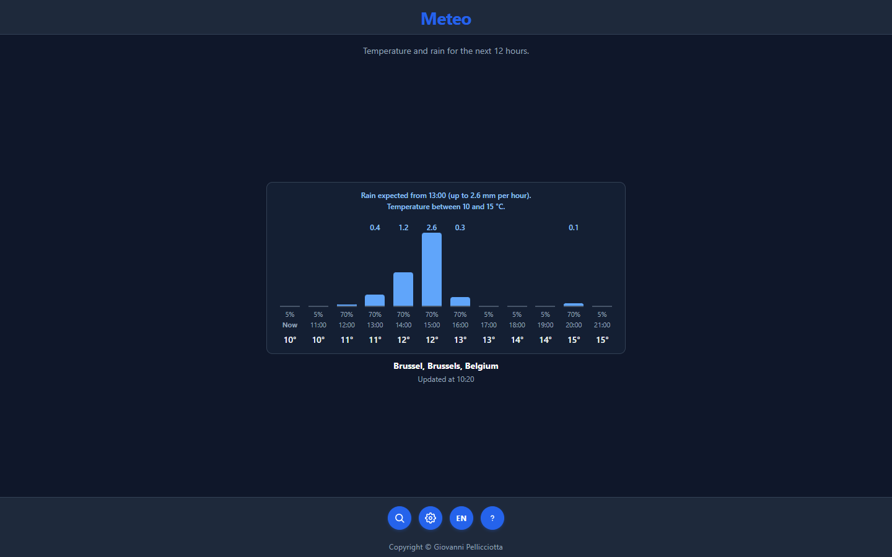 
- about, 390 px light: 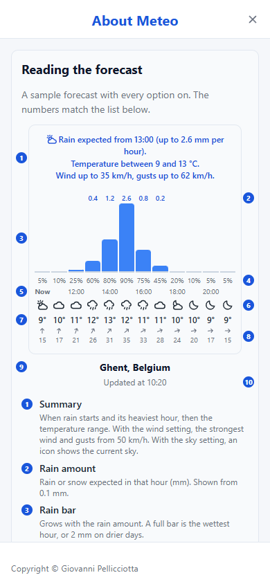 
- about, 390 px dark: 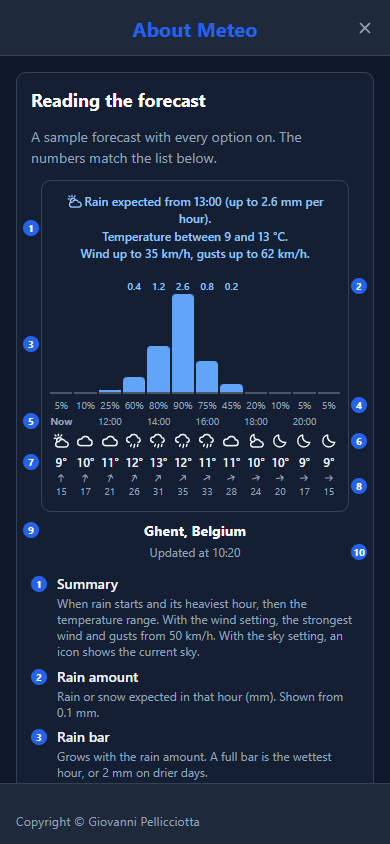 
- about, 1440 px light:  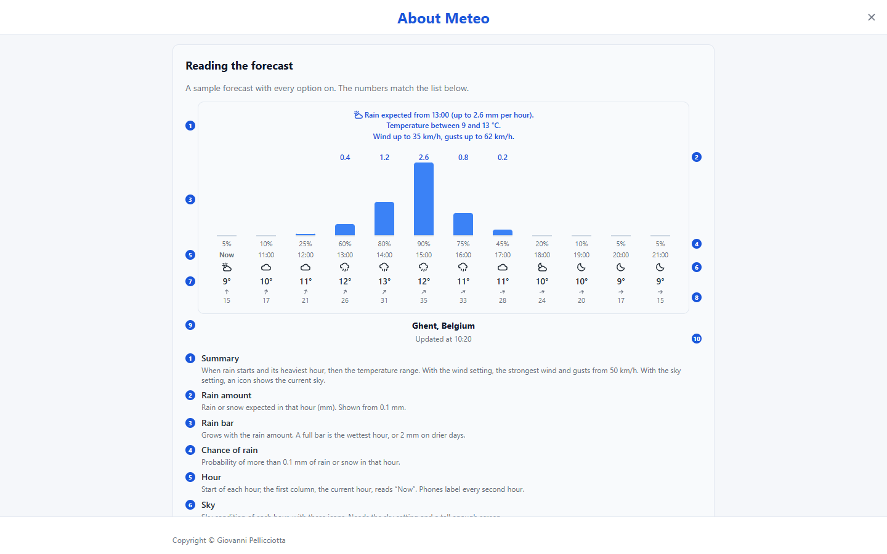
- about, 1440 px dark: 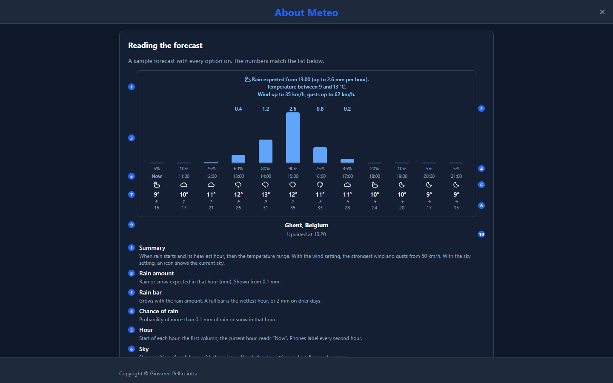 
- config, 390 px light: 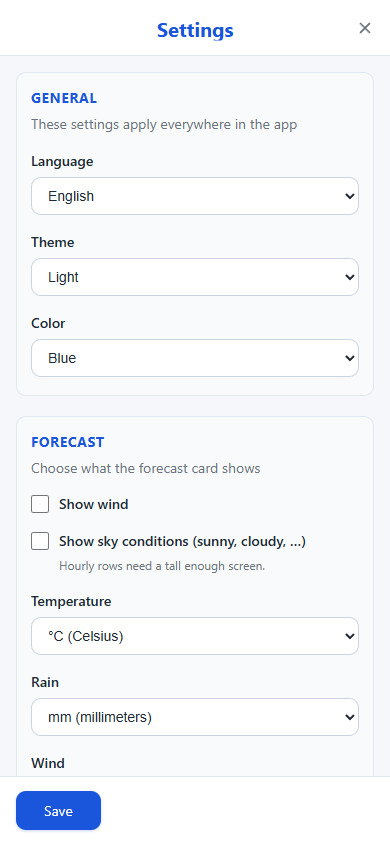 
- config, 390 px dark: 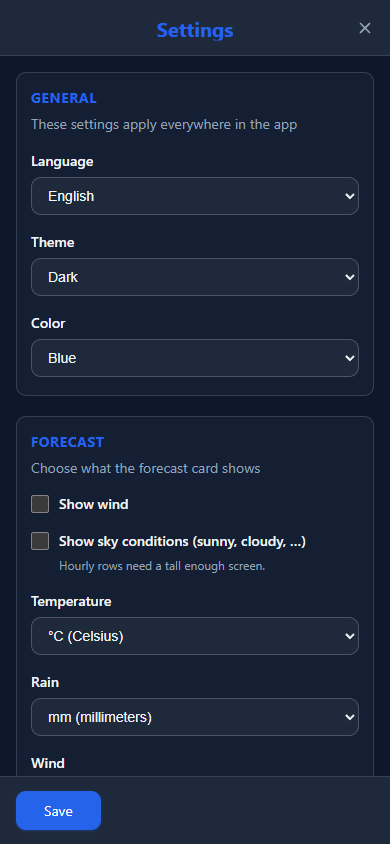 
- config, 1440 px light: 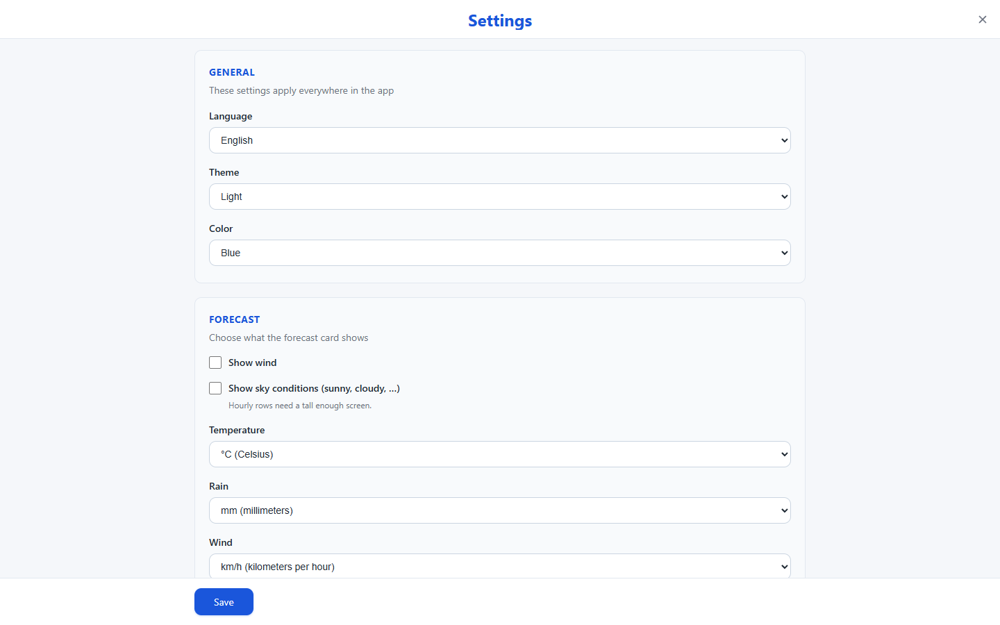 
- config, 1440 px dark:  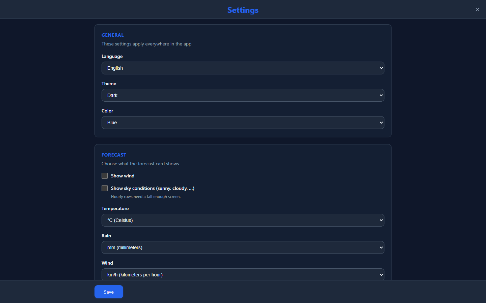
